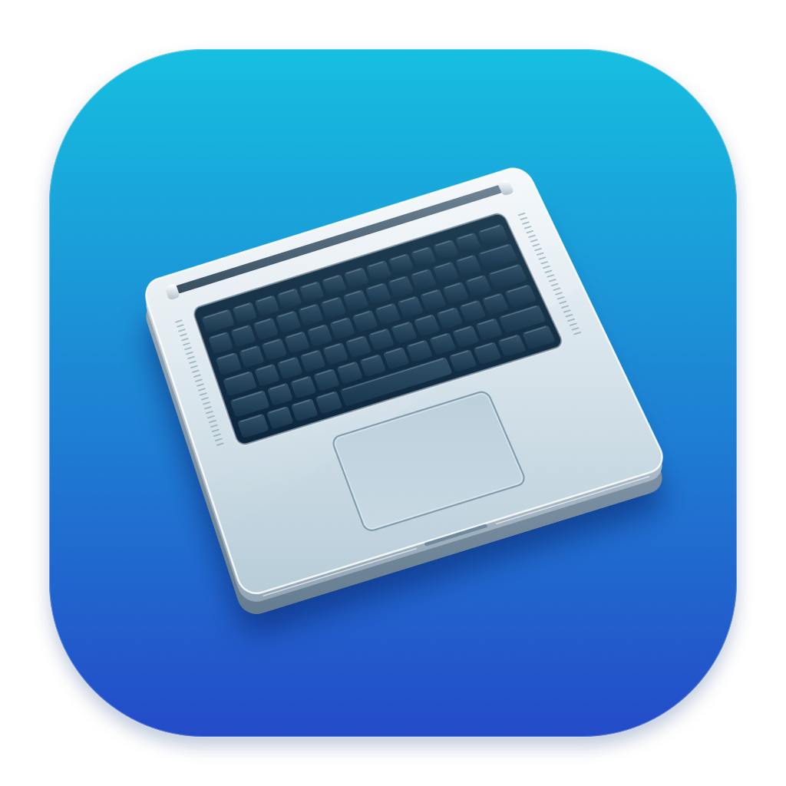

# Slabtop

A little app for a laptop with a little less laptop.

Use your wired monitors and TVs as the desktop on a MacBook with a missing or unusable built-in screen.

Slabtop is a native macOS menu bar app for Apple Silicon MacBooks. It activates the external desktop before disconnecting the built-in display in software. It also handles the macOS TV chooser state where a connected TV is waiting for a desktop.

**[Download Slabtop](https://github.com/alxcrt/slabtop/releases/latest)**

Early release for macOS 14 or later on Apple Silicon Macs starting with M1, including MacBook Air and MacBook Pro. Display control uses capability detection rather than a chip or macOS version allowlist. Hardware coverage is limited, and automatic reconnect and wake behavior need further testing. Read the [compatibility record](docs/COMPATIBILITY.md) before relying on the app.

## Get started

You need a working way to reach your logged-in Mac desktop for the first setup.

1. Download the release DMG and open it.
2. Drag **Slabtop.app** onto **Applications** in the installer window.
3. Open **Slabtop**.
4. Connect your wired monitors or TVs.
5. Click **Use external screens**.
6. Turn on **Use automatically**.
7. Turn on **Open at login**.

The app stays in the menu bar when you close its window. It checks display changes and wake events while it runs. It preserves your selected resolution, refresh rate, and relative screen positions. Picture controls, including HDR, remain in macOS Display settings.

The download is ad hoc signed and is **not Apple-notarized**. If macOS blocks the first launch, follow Apple's per-app **Open Anyway** procedure in the [user guide](docs/USER-GUIDE.md#open-the-download). No Terminal commands are needed for normal use.

## Recover your desktop

These shortcuts work while Slabtop runs, unless another app has reserved them.

| Shortcut | Action |
| --- | --- |
| Control + Option + Command + E | Use the external screens. |
| Control + Option + Command + R | Pause automatic mode and re-enable the built-in display in software. |

The same actions are in the app window and menu bar. Re-enabling a display cannot repair a damaged panel or restore a physically removed screen.

## Scope

Slabtop activates all identifiable wired external displays before disconnecting the built-in display. It keeps an existing external main screen and preserves the relative arrangement of the external screens. It pauses if an active or online unknown, virtual, or wireless output prevents a safe change.

Slabtop does not change display modes, power settings, FileVault, or automatic login. The Mac model and connection still determine how many screens and which modes work.

The app works after login. It cannot run at the FileVault unlock screen, in Recovery, or during early startup. A missing lid or display assembly can also affect sensors, antennas, cameras, and sleep behavior. See the [hardware limits](docs/COMPATIBILITY.md#hardware-and-startup-limits).

There is no paid app dependency. If BetterDisplay also manages the built-in display automatically, disable its conflicting automatic rule before enabling Slabtop's automatic mode.

## Documentation

- [Set up, recover, and remove the app](docs/USER-GUIDE.md).
- [Supported configurations and test status](docs/COMPATIBILITY.md).
- [Design evidence and related projects](docs/RESEARCH.md).
- [Build and contribute](CONTRIBUTING.md).
- [Report a security issue](SECURITY.md).

## License and credits

Slabtop is available under the [MIT license](LICENSE).

Research benefited from [BetterDisplay](https://github.com/waydabber/BetterDisplay), [displayplacer](https://github.com/jakehilborn/displayplacer), [displaytoggle](https://github.com/calvincchan/displaytoggle), and [Clamless](https://github.com/TCXM/clamless). Slabtop does not bundle or require these apps. Its implementation was written independently. See the [research notes](docs/RESEARCH.md).
